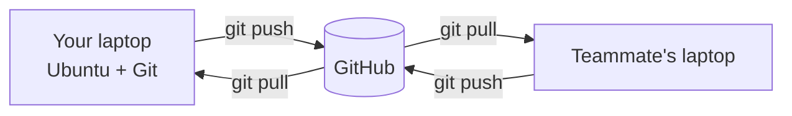

# What are Git, GitHub & Linux?

## Linux and Ubuntu

**Linux** is an operating system, like Windows or macOS. It runs most servers, most robots, and the Raspberry Pi. It comes in several versions called *distributions*; the club uses **Ubuntu**, the most common one in robotics. ROS 2, the framework most robots are built on, is developed for Ubuntu first.

On Linux you often work in a **terminal**: you type commands instead of clicking. It feels slow at first, but it's how you'll install software, run robot code, and connect to a robot over the network, often without any screen at all.

## Git

**Git** is a *version control system*. It runs on your computer and records snapshots of a project, called **commits**, over time. With Git you can:

- See exactly what changed, when, and who changed it
- Go back to any earlier version when something breaks
- Try ideas on a separate **branch** without touching working code

A project tracked by Git is called a **repository**, or **repo**.

## GitHub

**GitHub** is a website that hosts Git repositories online. Git tracks your project on your laptop; GitHub is where you share it so everyone has the same copy. GitHub adds:

- A backup of your code
- **Pull requests**: a way to propose changes and have teammates review them before they're merged
- Issues, project boards and websites, like this one

!!! info "Git ≠ GitHub"
    Git is the tool and GitHub is a service built around it. You can use Git without GitHub, but not the other way round.

## How they fit together

You write code and make commits on your own computer, push them to GitHub, and teammates pull them down.
