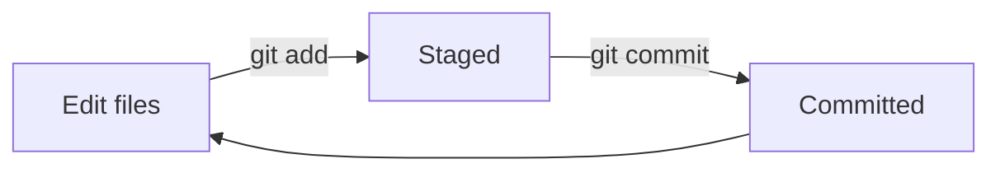

# Your first repository

You'll create a repo on your computer, make some commits, and look at the history.

## Create the repo

```bash
cd ~
mkdir my-robot
cd my-robot
git init
```

`git init` turns the current folder into a Git repository by adding a hidden `.git` folder, where Git keeps its history. Don't edit anything inside `.git`.

## The basic loop

Using Git is mostly the same three steps, over and over:



1. **Edit** files as usual.
2. **Stage** the changes you want in the next snapshot with `git add`.
3. **Commit** the snapshot with a message describing it, using `git commit`.

## Make your first commit

Create a README:

```bash
nano README.md
```

Write something like:

```markdown
# My Robot

A robot that will one day drive itself.
```

Save and exit, then ask Git what it sees:

```bash
git status
```

`README.md` is listed as **untracked**: Git sees it but isn't recording it yet. Stage it and check again:

```bash
git add README.md
git status
```

It's now under **Changes to be committed**. Commit it:

```bash
git commit -m "Add README"
```

!!! tip "Writing good commit messages"
    Describe *what the change does*, in a short command: `Add motor wiring notes`, `Fix LED pin number`. Avoid `stuff` or `update`. Six months from now you'll need to find this commit.

## Make more commits

Add a parts list:

```bash
nano parts.md
```

```markdown
# Parts

- 2× DC motors
- Arduino Uno
```

Then edit `README.md` and add a line at the bottom. Before staging, see exactly what changed:

```bash
git diff
```

Lines starting with `+` were added and lines with `-` were removed. Stage and commit both files:

```bash
git add .
git commit -m "Add parts list and expand README"
```

`git add .` stages every change in the current folder.

## Look at the history

```bash
git log --oneline
```

```text
b7e21c4 (HEAD -> main) Add parts list and expand README
3f9a0d2 Add README
```

Each commit has an ID (`b7e21c4`). Use `git show <id>` to see what a commit changed.

## Undoing things

| Situation | Command |
|---|---|
| Throw away unstaged edits to a file | `git restore parts.md` |
| Unstage a file (keep your edits) | `git restore --staged parts.md` |
| Fix the message of your last commit | `git commit --amend -m "Better message"` |

!!! warning
    `git restore <file>` permanently discards your unsaved edits to that file.

## Ignoring files

Some files shouldn't go in Git: build output, logs, passwords and API keys. List them in a file called `.gitignore`:

```bash
nano .gitignore
```

```text
build/
*.log
.env
```

```bash
git add .gitignore
git commit -m "Add .gitignore"
```

!!! danger "Never commit passwords or keys"
    Once something is pushed to GitHub, assume it's public forever, even if you delete it later.

## Exercise

Make two more commits on your own. For example, add a `notes/` folder with a file in it. Then run `git log --oneline` and check you see five commits.
