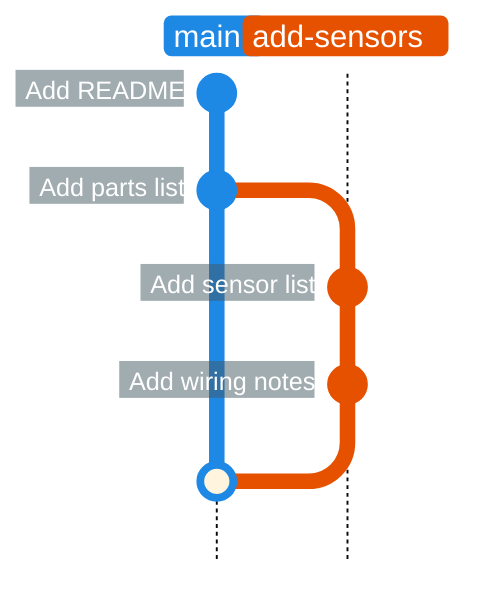

# Branches

A **branch** is a separate line of work. You can try something on a branch without affecting `main`, then merge it in when it works.



On a team, `main` should always work. New features and fixes happen on branches.

## Create and switch branches

```bash
cd ~/my-robot
git switch -c add-sensors     # create a branch and switch to it
git branch                    # list branches; * marks the current one
```

Make a commit on the branch:

```bash
nano sensors.md
git add sensors.md
git commit -m "Add sensor list"
```

Switch back to `main`:

```bash
git switch main
ls
```

`sensors.md` is gone. It exists only on the `add-sensors` branch. Switch back and it returns:

```bash
git switch add-sensors
ls
```

!!! warning "Commit before switching"
    If you have uncommitted changes, Git may refuse to switch branches. Commit them first.

## Merge a branch

When the work is done, merge it into `main`:

```bash
git switch main
git merge add-sensors
git log --oneline
```

`main` now has the sensor commit. Delete the branch, since its work is in `main`:

```bash
git branch -d add-sensors
git push
```

## Naming branches

Use short, descriptive names with hyphens, such as `add-lidar-driver`, `fix-motor-direction` or `docs-wiring`.

## Exercise

1. Create a branch called `add-goals`.
2. Add a `goals.md` file and commit it.
3. Edit `README.md` on the same branch and commit again.
4. Merge it into `main`, delete the branch, and push.

On a team you usually don't merge into `main` on your own laptop. You open a **pull request** so someone can review first, which is the next lesson.
