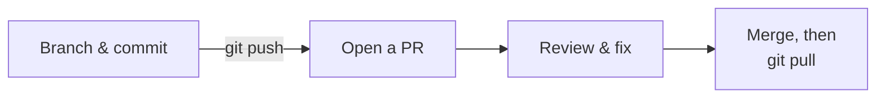

# Pull requests

A **pull request** (PR) asks to merge one branch into another on GitHub. Teammates can see the changes, comment, and approve before anything reaches `main`. Most of the club's repos require a PR for every change.

## The workflow



## 1. Make a branch and commit

```bash
cd ~/my-robot
git switch main
git pull
git switch -c add-wiring-notes
nano wiring.md
git add wiring.md
git commit -m "Add wiring notes"
```

## 2. Push the branch

```bash
git push -u origin add-wiring-notes
```

## 3. Open the pull request

Go to your repo on GitHub. A yellow banner offers **Compare & pull request**: click it. (Or go to **Pull requests** → **New pull request** and pick your branch.)

- **Title:** what the change does.
- **Description:** why, and anything a reviewer should check.

Click **Create pull request**.

!!! tip "From the terminal"
    `gh pr create` opens a PR for the current branch and asks for a title and description.

## 4. Review

On the PR, open the **Files changed** tab. Reviewers can click a line to comment on it, then **Review changes** to approve or request changes.

To make a fix after a review comment, just commit and push to the same branch. The PR updates automatically:

```bash
nano wiring.md
git commit -am "Clarify motor driver pins"
git push
```

`git commit -am` stages and commits every file Git already tracks. It doesn't pick up new files.

## 5. Merge

Once it's approved, click **Merge pull request**, then **Delete branch**.

## 6. Update your laptop

The merge happened on GitHub, so your local `main` is behind:

```bash
git switch main
git pull
git branch -d add-wiring-notes
```

## Exercise

Open a PR that adds a `team.md` file listing your name and role. Review it yourself on GitHub (you can comment on your own PR, though not approve it), merge it, and update your local `main`.
