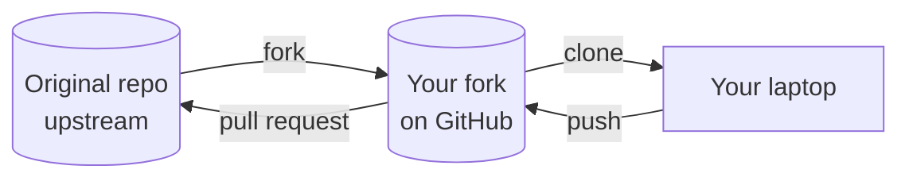

# Forks: contributing to other projects

To be a collaborator, the owner has to add you. For a project you **don't** have access to, such as an open-source library or another team's repo, you **fork** it: make your own copy on GitHub, change that, and open a pull request back to the original.



## Practice: add yourself to the club's practice repo

!!! note "TODO: create the practice repo"
    Create `ARC-GMU/git-practice` with a `members/` folder and a README explaining the exercise, then update the links below.

### 1. Fork and clone

```bash
cd ~
gh repo fork ARC-GMU/git-practice --clone
cd git-practice
```

This creates `<your-username>/git-practice` on GitHub and clones it. `gh` also sets up two remotes:

```bash
git remote -v
```

- `origin`: your fork. You can push here.
- `upstream`: the original repo. You can't push here, but you can pull from it.

(Without `gh`: click **Fork** on the repo's GitHub page, then `git clone` your fork.)

### 2. Make your change on a branch

```bash
git switch -c add-<your-username>
nano members/<your-username>.md
```

Write a couple of lines about yourself, such as your major and what you want to build. Then commit and push to **your fork**:

```bash
git add members/
git commit -m "Add <your-username> to members"
git push -u origin add-<your-username>
```

### 3. Open a pull request to the original repo

```bash
gh pr create --repo ARC-GMU/git-practice
```

Or, on GitHub, open your fork and click **Contribute** → **Open pull request**. Check that the base repository is `ARC-GMU/git-practice`.

A club officer will review and merge it.

## Keeping your fork up to date

The original repo keeps changing after you fork it. To bring those changes into your copy:

```bash
git switch main
git pull upstream main
git push origin main
```

## What's next

You've learned the workflow most software teams use every day. Keep practising:

- Put your workshop code from other workshops in your own GitHub repos.
- Pick an issue on one of the club's repos and open a PR for it.
